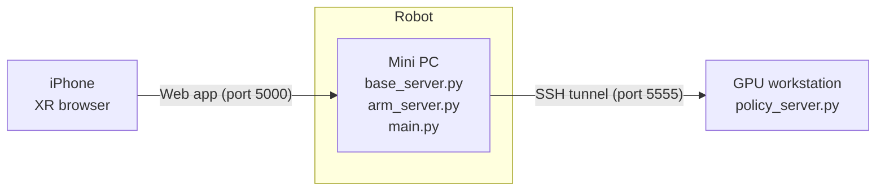

# PRPL TidyBot++ Policy Inference

Policy inference infrastructure for the PRPL TidyBot++ mobile manipulator.
The robot's onboard mini PC runs the real-time base and arm controllers, a GPU workstation serves the policy, and an iPhone running the XR browser is used to start, pause, and reset inference episodes.

## System overview



## Running policy inference

Inference requires three machines on the same network: the onboard **mini PC**, a **GPU workstation** running the policy, and an **iPhone** running the XR browser.

### 1. Start the base server (mini PC)

SSH into the mini PC and start a `tmux` session with four windows. In window 1, start the base RPC server:

```bash
python base_server.py
```

### 2. Start the arm server (mini PC)

In `tmux` window 2, start the arm RPC server:

```bash
python arm_server.py
```

### 3. Launch the policy server (GPU workstation)

On the GPU workstation, start the policy server with your checkpoint:

```bash
python policy_server.py --ckpt-path <checkpoint-path>
```

The policy server listens on port `5555`.

### 4. Create an SSH tunnel to the policy server (mini PC)

In `tmux` window 3 on the mini PC, forward port `5555` to the GPU workstation so the policy server is reachable at `localhost:5555`:

```bash
ssh -L 5555:localhost:5555 <user>@<gpu-workstation-hostname>
```

### 5. Run `main.py` (mini PC)

In `tmux` window 4 on the mini PC, start the policy inference loop:

```bash
python main.py
```

This starts a Flask server on port `5000`, which serves the phone web app used to control inference episodes.

### 6. Control inference from the phone (XR browser)

1. Connect the iPhone to the same network as the mini PC.
1. Open the **XR Browser** (or **XRViewer**) app and go to `<minipc-hostname>:5000`.
    * If that does not connect, try `<minipc-hostname>.local:5000` or the mini PC's IP address, e.g. `192.168.1.10:5000`.
1. Mount or hold the phone so it faces the same direction as the robot. The phone must be aligned with the robot whenever you press "Start episode".
1. Press **Start episode**.
1. Touch and hold your thumb on the screen to enable the robot and let the policy run.
1. Lift your thumb to pause policy execution. The robot holds its pose while paused.
1. Press **End episode** when the task is done (or fails).
1. Use phone teleoperation to retract the arm and drive the base back to its start position:
    * **Arm:** hold your thumb in the center of the screen (it turns blue) and move the phone.
    * **Gripper:** slide your thumb up or down on the screen.
    * **Base:** hold your thumb on the right edge of the screen (it turns red) and move the phone.
1. Press **Reset env**, then manually reset the objects in the scene.
1. Realign the phone with the robot and press **Start episode** to run the next episode.

> [!TIP]
> The phone screen shows round-trip time (RTT) statistics. Expect around 7 ms on 5 GHz Wi-Fi; if you see latency spikes, consider a USB-C to Ethernet adapter.

## Reference

This codebase builds on TidyBot++. For full operating instructions, see the TidyBot++ usage guide: https://tidybot2.github.io/docs/usage/

## Citation

This codebase is built on TidyBot++. If you find it useful for your research, please consider citing:

```
@inproceedings{wu2024tidybot,
  title = {TidyBot++: An Open-Source Holonomic Mobile Manipulator for Robot Learning},
  author = {Wu, Jimmy and Chong, William and Holmberg, Robert and Prasad, Aaditya and Gao, Yihuai and Khatib, Oussama and Song, Shuran and Rusinkiewicz, Szymon and Bohg, Jeannette},
  booktitle = {Conference on Robot Learning},
  year = {2024}
}
```
